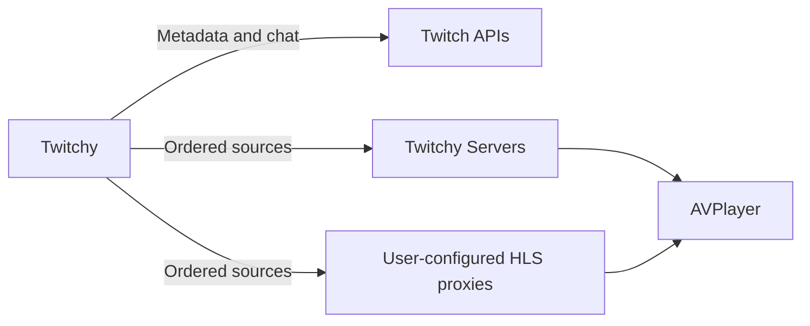

<div align="center">
  

  <br />

  <a href="#get-started"></a>
  <a href="https://www.swift.org/"></a>
  <a href="LICENSE"></a>
  <a href="CHANGELOG.md"></a>

  <p><strong>A fresh way to explore Twitch, designed specifically for the Apple ecosystem.</strong></p>

  <p>
    <a href="#why-twitchy">Explore features</a> ·
    <a href="#get-started">Get started</a> ·
    <a href="#twitchy-server">Twitchy Server</a> ·
    <a href="#how-streaming-works">How it works</a> ·
    <a href="docs/ROADMAP.md">Roadmap</a> ·
    <a href="#contribute">Contribute</a>
  </p>
</div>

---

# Twitchy — native Twitch client for Apple devices

**Twitch should feel at home on your Apple devices.**

Twitchy is an open-source, native **SwiftUI** Twitch-compatible client for **iPhone, iPad, Mac, and Apple TV**. It brings channel discovery, chat, playback controls and watch history into a native interface, with user-configured video sources.

Sign in directly with Twitch for discovery and chat. Open **Sources → + → Add Source** to choose **Twitch Proxy** or **Twitchy Server**, then set their fallback order. Twitchy does not bundle a public proxy, video extractor or streaming backend.

**Project position:** Twitchy is an independent, source-configurable client, not an ad blocker. Proxies are entered and selected by users; Twitchy does not operate or endorse third-party ad-blocking services, promise ad-free playback, or establish permission to access or redistribute content. Only use services and content you are permitted to use.

> [!IMPORTANT]
> **Early development preview · v0.1.0**
> Twitchy is currently distributed as **source code for self-building**, not as a downloadable app or App Store release. Live proxy playback has bounded local verification; real Twitch account consent, physical-device behavior and multi-device CloudKit transport remain unverified. See [verification](docs/VERIFICATION.md) and [known limitations](docs/LIMITATIONS.md).

<a id="why-twitchy"></a>

## Sources and fallback order

Add sources through **Sources → + → Add Source**. Mix and reorder them, for example **Twitchy Server 1 → Twitchy Server 2 → your proxy**. Enabled providers are tried in that order. Their type, configuration, enablement and order synchronize through private iCloud records in provisioned builds.

Twitchy Server and HLS proxy playback use AVPlayer. New downloads require a capable, connected Twitchy Server; saved local files remain playable offline.

No public proxy is bundled or selected automatically. Proxy diagnostics and setup are in [sources](docs/SOURCES.md), [playback architecture](docs/PROXY_FALLBACK.md) and [dated research](docs/PROXY_RESEARCH.md). These are operational observations, not endorsements or service guarantees.

On macOS, **Settings → Discord** can share the current channel and elapsed viewing time with the Discord desktop app. It is off by default. The Twitchy Discord application is preconfigured.

## 💜 Why Twitchy?

| | |
| :--- | :--- |
| **📱 Native on four platforms** <br /> SwiftUI interfaces for iOS, iPadOS, macOS and tvOS. No web-wrapper UI. | **🎬 Playback that feels native** <br /> AVPlayer, HLS, fullscreen, quality controls, and supported picture-in-picture and theater experiences. |
| **💬 Chat where you watch** <br /> Twitch EventSub chat with message receiving, reconnection, and sending; additional emote polish is in progress. | **🕘 Pick up where you left off** <br /> Local watch history, VOD resume positions, recent searches, and viewing-based live recommendations. |
| **📥 Take authorized content offline** <br /> Download jobs with progress, cancellation, retry, and local MP4 playback on iPhone, iPad, and Mac. | **☁️ Bring your settings along** <br /> Optional, privately stored CloudKit sync for sources, credentials, preferences, searches, and history, with your own provisioning. |
| **🔐 No built-in telemetry** <br /> Device-only Keychain storage for Twitch authentication and no bundled client secret. | **🧩 Open by design** <br /> MIT-licensed code, modular Swift packages, and an explicitly documented streaming-source contract. |
| **🔀 Your source order** <br /> Combine servers and permitted custom HLS proxies in a fallback order you control. | **🖥️ Run your own streaming source** <br /> Self-host Twitchy Server with Docker, or connect another source implementing the documented v1 API. |

<a id="twitchy-server"></a>

## Twitchy Server — optional self-hosted source

[Twitchy Server](https://github.com/rafaelreverberi/twitchy-server) is a separate, optional Source API v1 backend. It can provide live/VOD/clip HLS and supported authorized downloads. Configure its independent credentials under **Add Source → Twitchy Server**. Backend behavior and permissions remain the operator’s responsibility; the app does not implement or guarantee ad removal. Other compatible servers can be used.

### Connect Twitchy Server

A quick local setup, if you want to use **Twitchy Server** as your source:

```bash
git clone https://github.com/rafaelreverberi/twitchy-server.git
cd twitchy-server
./scripts/setup.sh
```

Then in **Twitchy → Profile → Settings → Sources → Add** (Apple TV: **Settings → Sources**):

1. Add the source URL. For the app running on the **same Mac** as the server, local development can use `http://localhost:8080` with the explicit local-HTTP exception.
2. Select **Bearer authentication** and enter the server's independent `local` source token from `secrets/tokens.json`.
3. Use **Check**, then select the source as **Primary**, then open a live channel. Your Twitch login and your server token are **separate** credentials.

**Before connecting another device**, set the server’s `PUBLIC_BASE_URL` to the same reachable address used by the app and restart the server; generated media URLs must be reachable from the player too.

**On iPhone, iPad, or Apple TV**, `localhost` refers to that device, **not your server**. Configure a reachable LAN address for local development or a trusted HTTPS endpoint for regular use. Follow the **[Twitchy Server setup guide](https://github.com/rafaelreverberi/twitchy-server/blob/main/docs/SETUP.md)** for Docker, HTTPS, and Tailscale, or see its **[repository & README](https://github.com/rafaelreverberi/twitchy-server)**.

<sub>Twitchy Server is one possible source, not a required component. Other sources implementing the [Twitchy Source API v1](docs/SERVER_API.md) can be used; their playback and ad behavior may differ.</sub>

### Made for the device you're using

| Platform | Experience |
| --- | --- |
| **iPhone** | Touch-first navigation, channels, search, chat, and native player features. |
| **iPad** | Adaptive layouts with side-by-side content and chat. A resizable divider is still planned. |
| **Mac** | Native sidebar, channel libraries, fixed chat column, theater mode, and persistent mini-player. |
| **Apple TV** | Focus-driven navigation, device-code / QR sign-in flow, and fullscreen playback. **No TV chat UI.** |

<a id="get-started"></a>

## 🚀 Get started

Twitchy is a project you **build with Xcode on a Mac**. You will need **Xcode 27.0** (development baseline), **Swift 6.4**, and the Apple SDK 27.0. Minimum deployment targets are **iOS / iPadOS / tvOS 17** and **macOS 14**.

**1. Clone the project**

```bash
git clone https://github.com/rafaelreverberi/Twitchy.git
cd Twitchy
open Twitchy.xcodeproj
```

**2. Pick your platform**

Choose **`Twitchy-macOS`**, **`Twitchy-iOS`** (iPhone/iPad), or **`Twitchy-tvOS`** in Xcode. For a real device, set up your own signing team, unique Bundle IDs, and (if using sync) iCloud container. The checked-in Xcode project is ready to open; XcodeGen is optional for maintainers.

**3. Sign in with Twitch**

Open **Set Up Twitch Connection** and follow the tutorial to register a Public application in the Twitch Developer Console. Save its Client ID in Twitchy and authorize the app on Twitch. Your Client ID syncs through private iCloud on a provisioned build. Authorize Twitch separately on each device. See [Twitch authentication](docs/TWITCH_AUTH.md).

**4. Add your streaming source (for video)**

Open **Profile → Settings → Sources → Add → Twitchy Server**, add a source that implements the [Twitchy Source API v1](docs/SERVER_API.md), test its capabilities, and select it. Alternatively, configure a permitted custom Twitch Proxy. The app does not filter or skip ads. You can browse and use chat without a streaming source, but **Twitch authorization is still required for Helix-based discovery**.

**Documentation hub:** [All guides](docs/README.md)

**Setup guides:** [Self-build & signing](docs/SELF_BUILD.md) · [Twitch OAuth](docs/TWITCH_AUTH.md) · [Streaming sources](docs/SOURCES.md) · [Detailed getting started](docs/GETTING_STARTED.md)

<a id="how-streaming-works"></a>

## 🔌 How streaming works

Discovery and chat use official Twitch OAuth, Helix and EventSub interfaces. Video follows your ordered, enabled Sources list. Twitchy Servers use the [v1 contract](docs/SERVER_API.md), and custom playlist proxies provide HLS to AVPlayer.



Server credentials stay with their own source. Proxies receive no native Twitch or server credentials. Twitchy provides no ad skipping, proxy network or guarantee of uninterrupted playback.

## 🛠️ What's built — and what's next

| Area | Current state |
| --- | --- |
| Native UI on iOS, iPadOS, macOS, and tvOS | **Implemented**; device-specific layouts, with development verification. |
| OAuth, token storage / refresh, official Twitch browsing | **Implemented**; real account authorization still needs validation. |
| Ordered server and proxy sources | **Implemented**; deterministic fallback tests, bounded live AVPlayer checks. See [research](docs/PROXY_RESEARCH.md). |
| EventSub chat and sending messages | **Implemented**; decoding and policy checks tested, live integration pending. |
| Authorized MP4 downloads | **Implemented** for foreground transfers; pause / resume and background transfers planned. |
| History, VOD resume, local recommendations | **Implemented**; recommendations use local viewing activity and Helix live status. |
| iCloud sync | **Implemented**; requires your own CloudKit provisioning. |
| Advanced emotes, tablet / Mac window refinements | **Partially implemented / planned**. |
| Global free-text clips / VOD search, follow mutation | **Not supported** through the current official API design. |

Source health checks and automatic fallback between enabled providers are implemented; see [source setup](docs/SOURCES.md). iPhone Companion Mode also has an implementation for Apple TV chat, with cross-device verification still pending.

See the [full roadmap](docs/ROADMAP.md), [changelog](CHANGELOG.md), and [detailed limitations](docs/LIMITATIONS.md) before relying on a specific feature.

## 🧑‍💻 Built with Swift, from the ground up

Twitchy uses seven modules in **`Packages/TwitchyKit`**:

`Core` · `API` · `Auth` · `Sources` · `Playback` · `Chat` · `DesignSystem`

Shared SwiftUI code lives in `Apps/Shared`, while the individual platform targets live in `Apps`. The project has **no third-party runtime dependencies**.

<details>
<summary><strong>Run the development checks</strong></summary>

```bash
./scripts/build.sh

# Start the local fixture server.
python3 MockServer/server.py --port 8181

# In another terminal:
TWITCHY_MOCK_URL=http://localhost:8181 swift test --package-path Packages/TwitchyKit

# Native macOS test destination:
xcodebuild -project Twitchy.xcodeproj -scheme Twitchy-macOS -destination 'platform=macOS' CODE_SIGN_IDENTITY=- test
```

These are development commands, **not a claim that remote CI or a real Twitch sign-in has passed**. Read the [verification evidence](docs/VERIFICATION.md).

</details>

### Developer documentation

| Guide | What's inside |
| --- | --- |
| [Architecture](docs/ARCHITECTURE.md) | Modules, layering, and dependencies. |
| [Source API](docs/SERVER_API.md) / [OpenAPI](docs/SERVER_API.json) | Versioned external playback-source contract. |
| [Twitchy Server](https://github.com/rafaelreverberi/twitchy-server) | Optional self-hosted video source. |
| [Authentication](docs/TWITCH_AUTH.md) | Twitch OAuth and device flow. |
| [Chat](docs/CHAT.md) | EventSub integration and policy boundaries. |
| [macOS interface](docs/MACOS_INTERFACE.md) / [tvOS interface](docs/TVOS_INTERFACE.md) | Platform-specific UI and verification. |
| [iCloud sync](docs/ICLOUD_SYNC.md) | Provisioning and private sync storage. |
| [Security](SECURITY.md) / [Privacy](PRIVACY.md) | Security model and data-handling details. |

## ❓ A few good questions

<details>
<summary><strong>Can I install Twitchy from the App Store?</strong></summary>

Not currently. This is a **0.1.0 development source release** for people who want to build and test the app in Xcode. No binary release is included with this update.

</details>

<details>
<summary><strong>Can I watch streams right after signing in?</strong></summary>

Channel discovery and chat use official Twitch APIs. Add a video provider through **Sources → +**: a permitted HLS proxy or a Twitchy Server. See [Sources](docs/SOURCES.md).

</details>

<details>
<summary><strong>Does Twitchy block ads?</strong></summary>

Twitchy is a configurable client and does not block or skip ads. Third-party providers are selected by users; their behavior is controlled by their operators. Twitchy does not operate or endorse ad-blocking proxy services or promise an ad-free experience.

</details>

<details>
<summary><strong>Is the project affiliated with Twitch?</strong></summary>

No. Twitchy is independently developed third-party software and is **not affiliated with, sponsored by, or endorsed by Twitch**.

</details>

<a id="contribute"></a>

## 🤝 Contribute

Twitchy is an independent project built by **Rafael Reverberi** — and contributions, bug reports, suggestions, and thoughtful feedback are welcome.

- Browse the [roadmap](docs/ROADMAP.md) for planned improvements.
- Open an [issue](https://github.com/rafaelreverberi/Twitchy/issues) for a reproducible bug or feature suggestion.
- Read [CONTRIBUTING.md](CONTRIBUTING.md) before opening a pull request.
- If you like the direction of Twitchy, **give the repository a ⭐** to help others find it.

<div align="center">
  <br />
  <strong>Crafted for Apple. Powered by SwiftUI. Made for your streams.</strong>
  <br /><br />
  <a href="https://github.com/rafaelreverberi/Twitchy">GitHub</a> ·
  <a href="docs/GETTING_STARTED.md">Documentation</a> ·
  <a href="docs/ROADMAP.md">Roadmap</a> ·
  <a href="https://github.com/rafaelreverberi/twitchy-server">Twitchy Server</a> ·
  <a href="LICENSE">MIT License</a>
</div>

---

<sub>**Legal & distribution:** Original Twitchy source code is available under the [MIT License](LICENSE). This license does not grant rights to Twitch trademarks or content. Review Twitch API, player, advertising, content, and distribution requirements before publishing or distributing an app. Implementation and local testing do not amount to approval. Twitchy is not affiliated with or endorsed by Twitch.</sub>
