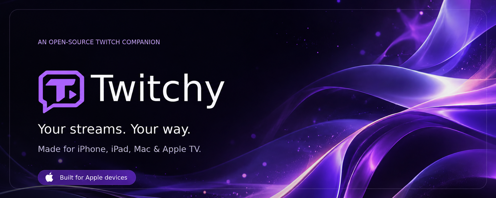
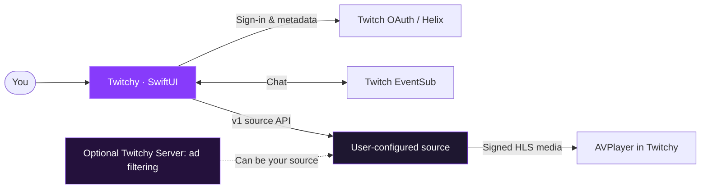

<div align="center">
  

  <br />

  <a href="#get-started"></a>
  <a href="https://www.swift.org/"></a>
  <a href="LICENSE"></a>
  <a href="CHANGELOG.md"></a>
  <a href="https://github.com/rafaelreverberi/twitchy-server"></a>

  <p><strong>A fresh way to explore Twitch, designed specifically for the Apple ecosystem.</strong></p>

  <p>
    <a href="#why-twitchy">Explore features</a> ·
    <a href="#get-started">Get started</a> ·
    <a href="#twitchy-server">Twitchy Server</a> ·
    <a href="#how-streaming-works">How it works</a> ·
    <a href="docs/ROADMAP.md">Roadmap</a> ·
    <a href="#contribute">Contribute</a>
  </p>
</div>

---

# Twitchy — native Twitch client for Apple devices

**Twitch should feel at home on your Apple devices.**

Twitchy is an open-source, native **SwiftUI** Twitch-compatible client for **iPhone, iPad, Mac, and Apple TV**. It brings channel discovery, real-time chat, native playback controls, watch history, and more into a thoughtfully designed app — instead of a website inside a window.

Sign in directly with Twitch to explore channels and discover streams. To **play video**, connect your own compatible streaming source. You're in control of the source you use; Twitchy never bundles a video extractor or a streaming backend.

**Looking for Twitch adblock on Apple devices?** Pair the app with **[Twitchy Server](https://github.com/rafaelreverberi/twitchy-server)**, the optional self-hosted streaming source. It can filter *recognized, marked ads* before video reaches the player. **The Twitchy app itself does not block ads**; filtering happens entirely in the separate server and is not guaranteed for every ad or stream. [See how it works ↓](#twitchy-server)

> [!IMPORTANT]
> **Early development preview · v0.1.0**
> Twitchy is currently distributed as **source code for self-building**, not as a downloadable app or App Store release. Features described as implemented have code and local verification, but **real Twitch account consent and end-to-end production streaming have not yet been verified**. See [verification](docs/VERIFICATION.md) and [known limitations](docs/LIMITATIONS.md).

<a id="why-twitchy"></a>

## 💜 Why Twitchy?

| | |
| :--- | :--- |
| **📱 Native on four platforms** <br /> SwiftUI interfaces for iOS, iPadOS, macOS and tvOS. No web-wrapper UI. | **🎬 Playback that feels native** <br /> AVPlayer, HLS, fullscreen, quality controls, and supported picture-in-picture and theater experiences. |
| **💬 Chat where you watch** <br /> Twitch EventSub chat with message receiving, reconnection, and sending; additional emote polish is in progress. | **🕘 Pick up where you left off** <br /> Local watch history, VOD resume positions, recent searches, and viewing-based live recommendations. |
| **📥 Take authorized content offline** <br /> Download jobs with progress, cancellation, retry, and local MP4 playback on iPhone, iPad, and Mac. | **☁️ Bring your settings along** <br /> Optional, privately stored CloudKit sync for sources, credentials, preferences, searches, and history, with your own provisioning. |
| **🔐 No built-in telemetry** <br /> Device-only Keychain storage for Twitch authentication and no bundled client secret. | **🧩 Open by design** <br /> MIT-licensed code, modular Swift packages, and an explicitly documented streaming-source contract. |
| **🛡️ Optional server-side ad filtering** <br /> [Twitchy Server](https://github.com/rafaelreverberi/twitchy-server) filters recognized, marked ads upstream and pauses output during ad breaks. **The app does not block ads.** | **🖥️ Run your own streaming source** <br /> Self-host Twitchy Server with Docker, or connect another source implementing the documented v1 API. |

<a id="twitchy-server"></a>

## 🛡️ Twitchy Server — optional server-side ad filtering

**Twitchy is the player. [Twitchy Server](https://github.com/rafaelreverberi/twitchy-server) is the optional, self-hosted streaming backend.** The two projects work together but have different responsibilities:

| | **Twitchy app** | **Twitchy Server** |
| :--- | :--- | :--- |
| **Purpose** | Native Apple interface, Twitch sign-in, channel discovery, chat, and AVPlayer playback. | Independent HLS video source for live streams, VODs, and clips. |
| **Ad filtering** | **None.** No ad blocker is included in the client. | **Server-side filtering of recognized, marked Twitch ad segments** when enabled. |
| **During an ad break** | Plays or buffers the HLS stream supplied by the chosen source. | Filters recognized ad media before delivery; its default filter/pause mode **pauses video output** until normal content returns. |
| **Installation** | Build the Apple app using Xcode. | Run an **optional, separate** Docker-based server on a computer, NAS, or authorized VPS you control. |

> [!IMPORTANT]
> **Filtering is not a guarantee of an ad-free or uninterrupted stream.** Twitchy Server's default mode filters ads identified by supported markers. Unmarked or unrecognized ads may still pass through, and video can buffer while a marked ad break is filtered. Filtering is **not performed by Twitchy itself**. Review the server's [ad-handling documentation](https://github.com/rafaelreverberi/twitchy-server/blob/main/docs/ADBLOCK.md), [verification limits](https://github.com/rafaelreverberi/twitchy-server/blob/main/docs/VERIFICATION.md), and applicable Twitch policies before using or distributing it.

### Connect Twitchy Server

A quick local setup, if you want to use **Twitchy Server** as your source:

```bash
git clone https://github.com/rafaelreverberi/twitchy-server.git
cd twitchy-server
./scripts/setup.sh
```

Then in **Twitchy → Profile → Settings → Sources → Add** (Apple TV: **Settings → Sources**):

1. Add the source URL. For the app running on the **same Mac** as the server, local development can use `http://localhost:8080` with the explicit local-HTTP exception.
2. Select **Bearer authentication** and enter the server's independent `local` source token from `secrets/tokens.json`.
3. Use **Check**, then select the source as **Primary**, then open a live channel. Your Twitch login and your server token are **separate** credentials.

**Before connecting another device**, set the server’s `PUBLIC_BASE_URL` to the same reachable address used by the app and restart the server; generated media URLs must be reachable from the player too.

**On iPhone, iPad, or Apple TV**, `localhost` refers to that device, **not your server**. Configure a reachable LAN address for local development or a trusted HTTPS endpoint for regular use. Follow the **[Twitchy Server setup guide](https://github.com/rafaelreverberi/twitchy-server/blob/main/docs/SETUP.md)** for Docker, HTTPS, and Tailscale, or see its **[repository & README](https://github.com/rafaelreverberi/twitchy-server)**.

<sub>Twitchy Server is one possible source, not a required component. Other sources implementing the [Twitchy Source API v1](docs/SERVER_API.md) can be used; their playback and ad behavior may differ.</sub>

### Made for the device you're using

| Platform | Experience |
| --- | --- |
| **iPhone** | Touch-first navigation, channels, search, chat, and native player features. |
| **iPad** | Adaptive layouts with side-by-side content and chat. A resizable divider is still planned. |
| **Mac** | Native sidebar, channel libraries, fixed chat column, theater mode, and persistent mini-player. |
| **Apple TV** | Focus-driven navigation, device-code / QR sign-in flow, and fullscreen playback. **No TV chat UI.** |

<a id="get-started"></a>

## 🚀 Get started

Twitchy is a project you **build with Xcode on a Mac**. You will need **Xcode 27.0** (development baseline), **Swift 6.4**, and the Apple SDK 27.0. Minimum deployment targets are **iOS / iPadOS / tvOS 17** and **macOS 14**.

**1. Clone the project**

```bash
git clone https://github.com/rafaelreverberi/Twitchy.git
cd Twitchy
open Twitchy.xcodeproj
```

**2. Pick your platform**

Choose **`Twitchy-macOS`**, **`Twitchy-iOS`** (iPhone/iPad), or **`Twitchy-tvOS`** in Xcode. For a real device, set up your own signing team, unique Bundle IDs, and (if using sync) iCloud container. The checked-in Xcode project is ready to open; XcodeGen is optional for maintainers.

**3. Sign in with Twitch**

Use **Sign in with Twitch** in the app. The default public-device flow uses a bundled **public Client ID** and supports token renewal; no client secret is embedded. Custom OAuth settings are available under **Settings → Advanced**. Real consent remains to be validated against a registered Twitch application.

**4. Add your streaming source (for video)**

Open **Profile → Settings → Sources**, add a source that implements the [Twitchy Source API v1](docs/SERVER_API.md), test its capabilities, and select it. If you want **optional server-side ad filtering**, you can run **[Twitchy Server](https://github.com/rafaelreverberi/twitchy-server)** and add it here; the **app does not filter ads**. You can browse and use chat without a streaming source, but **Twitch authorization is still required for Helix-based discovery**.

**Documentation hub:** [All guides](docs/README.md)

**Setup guides:** [Self-build & signing](docs/SELF_BUILD.md) · [Twitch OAuth](docs/TWITCH_AUTH.md) · [Streaming sources](docs/SOURCES.md) · [Detailed getting started](docs/GETTING_STARTED.md)

<a id="how-streaming-works"></a>

## 🔌 How streaming works

One intentional separation makes Twitchy different:

- **Your Twitch connection:** Authentication, channel / stream information, search, and chat use official Twitch **OAuth**, **Helix**, and **EventSub** interfaces.
- **Your video connection:** Playback is supplied **only** by a user-configured, compatible source implementing the [versioned v1 contract](docs/SERVER_API.md). Twitchy consumes its HLS output through AVPlayer.
- **Optional server-side filtering:** [Twitchy Server](https://github.com/rafaelreverberi/twitchy-server) is a separate, self-hosted source. When enabled, it uses Streamlink to filter *recognized, marked* ad segments and FFmpeg to serve its own HLS output, potentially pausing the video during ad breaks. The **client performs no ad filtering**.
- **Your credentials:** The `SourceClient` dependency boundary prevents it from accessing Twitch credentials. Server access uses an independent source credential; no unofficial extraction fallback, production streaming backend, or bundled client secret is included in the app repository.



> [!NOTE]
> Twitchy **the app** does **not** acquire streams, remove ads, or bypass Twitch restrictions. **Optional [Twitchy Server](https://github.com/rafaelreverberi/twitchy-server) handles stream acquisition and recognized-ad filtering separately**. Filtering is limited and may cause buffering; it cannot guarantee an ad-free experience. Source operators remain responsible for applicable Twitch policies and content rights.

## 🛠️ What's built — and what's next

| Area | Current state |
| --- | --- |
| Native UI on iOS, iPadOS, macOS, and tvOS | **Implemented**; device-specific layouts, with development verification. |
| OAuth, token storage / refresh, official Twitch browsing | **Implemented**; real account authorization still needs validation. |
| Streaming sources and AVPlayer / HLS playback | **Implemented**; verified with generated local HLS fixtures, not real production streams. |
| Server-side ad filtering | **Available in the separate, optional [Twitchy Server](https://github.com/rafaelreverberi/twitchy-server)**; not implemented in the app. Filters recognized marked ads in server tests, not a guarantee of real-world ad-free playback. |
| EventSub chat and sending messages | **Implemented**; decoding and policy checks tested, live integration pending. |
| Authorized MP4 downloads | **Implemented** for foreground transfers; pause / resume and background transfers planned. |
| History, VOD resume, local recommendations | **Implemented**; recommendations use local viewing activity and Helix live status. |
| iCloud sync | **Implemented**; requires your own CloudKit provisioning. |
| Advanced emotes, tablet / Mac window refinements | **Partially implemented / planned**. |
| Global free-text clips / VOD search, follow mutation | **Not supported** through the current official API design. |

Source health checks and automatic fallback between enabled servers are implemented; see [source setup](docs/SOURCES.md). iPhone Companion Mode also has an implementation for Apple TV chat, with cross-device verification still pending.

See the [full roadmap](docs/ROADMAP.md), [changelog](CHANGELOG.md), and [detailed limitations](docs/LIMITATIONS.md) before relying on a specific feature.

## 🧑‍💻 Built with Swift, from the ground up

Twitchy uses seven modules in **`Packages/TwitchyKit`**:

`Core` · `API` · `Auth` · `Sources` · `Playback` · `Chat` · `DesignSystem`

Shared SwiftUI code lives in `Apps/Shared`, while the individual platform targets live in `Apps`. The project has **no third-party runtime dependencies**.

<details>
<summary><strong>Run the development checks</strong></summary>

```bash
./scripts/build.sh

# Start the local fixture server.
python3 MockServer/server.py --port 8181

# In another terminal:
TWITCHY_MOCK_URL=http://localhost:8181 swift test --package-path Packages/TwitchyKit

# Native macOS test destination:
xcodebuild -project Twitchy.xcodeproj -scheme Twitchy-macOS -destination 'platform=macOS' CODE_SIGN_IDENTITY=- test
```

These are development commands, **not a claim that remote CI or a real Twitch sign-in has passed**. Read the [verification evidence](docs/VERIFICATION.md).

</details>

### Developer documentation

| Guide | What's inside |
| --- | --- |
| [Architecture](docs/ARCHITECTURE.md) | Modules, layering, and dependencies. |
| [Source API](docs/SERVER_API.md) / [OpenAPI](docs/SERVER_API.json) | Versioned external playback-source contract. |
| [Twitchy Server](https://github.com/rafaelreverberi/twitchy-server) / [Ad handling](https://github.com/rafaelreverberi/twitchy-server/blob/main/docs/ADBLOCK.md) | Optional self-hosted backend, filtering behavior, and its limitations. |
| [Authentication](docs/TWITCH_AUTH.md) | Twitch OAuth and device flow. |
| [Chat](docs/CHAT.md) | EventSub integration and policy boundaries. |
| [macOS interface](docs/MACOS_INTERFACE.md) / [tvOS interface](docs/TVOS_INTERFACE.md) | Platform-specific UI and verification. |
| [iCloud sync](docs/ICLOUD_SYNC.md) | Provisioning and private sync storage. |
| [Security](SECURITY.md) / [Privacy](PRIVACY.md) | Security model and data-handling details. |

## ❓ A few good questions

<details>
<summary><strong>Can I install Twitchy from the App Store?</strong></summary>

Not currently. This is a **0.1.0 development source release** for people who want to build and test the app in Xcode. No binary release is included with this update.

</details>

<details>
<summary><strong>Can I watch streams right after signing in?</strong></summary>

Channel discovery and chat use official Twitch APIs. **Video is different:** you need to add a compatible, user-configured streaming source before HLS playback can work. You can use [Twitchy Server](https://github.com/rafaelreverberi/twitchy-server) or another compatible source. See [Sources](docs/SOURCES.md).

</details>

<details>
<summary><strong>Does Twitchy block ads? How does Twitchy Server help?</strong></summary>

**The Twitchy app does not block ads or extract streams.** Ad filtering is available **only if you choose to run a compatible server that implements it**, such as **[Twitchy Server](https://github.com/rafaelreverberi/twitchy-server)**. That separate project uses server-side filtering for recognizable, marked Twitch ad segments; the default behavior pauses output during those breaks. Unknown or unmarked ads may not be filtered. This is **not a promise of always ad-free or uninterrupted playback**. See [server ad handling](https://github.com/rafaelreverberi/twitchy-server/blob/main/docs/ADBLOCK.md).

</details>

<details>
<summary><strong>Is the project affiliated with Twitch?</strong></summary>

No. Twitchy is independently developed third-party software and is **not affiliated with, sponsored by, or endorsed by Twitch**.

</details>

<a id="contribute"></a>

## 🤝 Contribute

Twitchy is an independent project built by **Rafael Reverberi** — and contributions, bug reports, suggestions, and thoughtful feedback are welcome.

- Browse the [roadmap](docs/ROADMAP.md) for planned improvements.
- Open an [issue](https://github.com/rafaelreverberi/Twitchy/issues) for a reproducible bug or feature suggestion.
- Read [CONTRIBUTING.md](CONTRIBUTING.md) before opening a pull request.
- If you like the direction of Twitchy, **give the repository a ⭐** to help others find it.

<div align="center">
  <br />
  <strong>Crafted for Apple. Powered by SwiftUI. Made for your streams.</strong>
  <br /><br />
  <a href="https://github.com/rafaelreverberi/Twitchy">GitHub</a> ·
  <a href="docs/GETTING_STARTED.md">Documentation</a> ·
  <a href="docs/ROADMAP.md">Roadmap</a> ·
  <a href="https://github.com/rafaelreverberi/twitchy-server">Twitchy Server</a> ·
  <a href="LICENSE">MIT License</a>
</div>

---

<sub>**Legal & distribution:** Original Twitchy source code is available under the [MIT License](LICENSE). This license does not grant rights to Twitch trademarks or content. Review Twitch API, player, advertising, content, and distribution requirements before publishing or distributing an app. Implementation and local testing do not amount to approval. Twitchy is not affiliated with or endorsed by Twitch.</sub>
