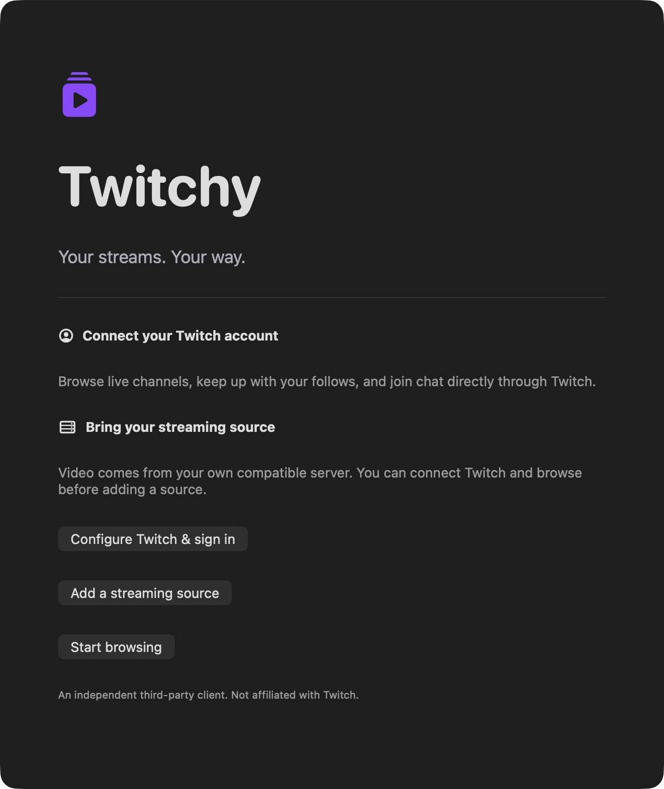
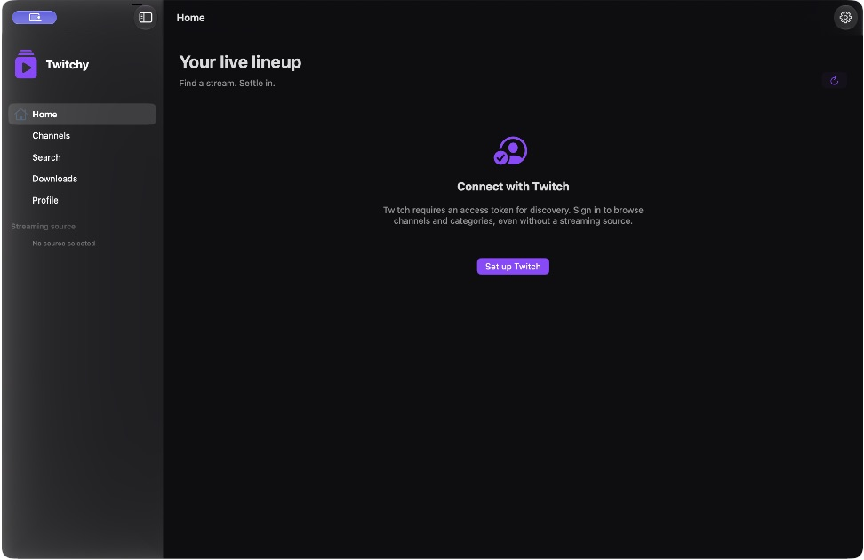
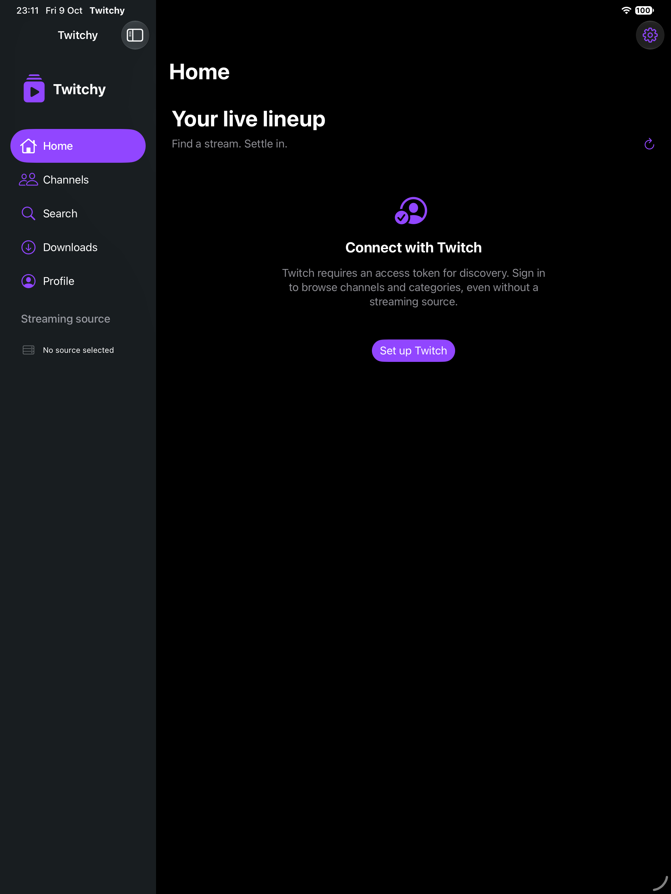
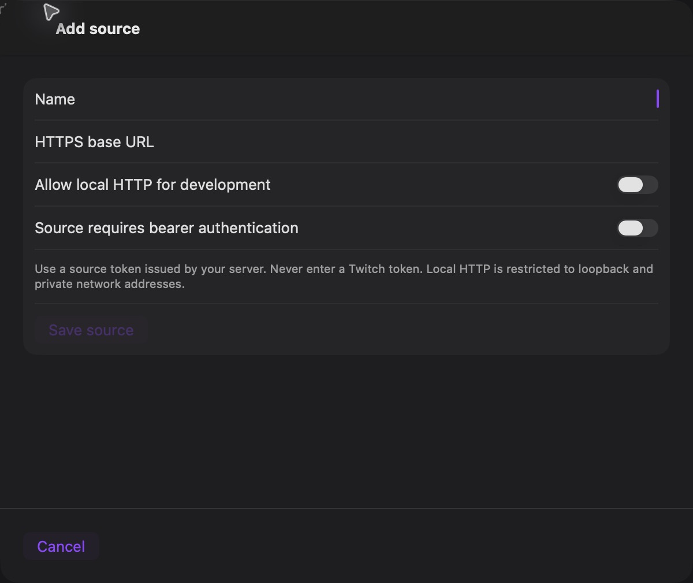

# Twitchy
**Your streams. Your way.**

A native SwiftUI Twitch-compatible client for iPhone, iPad, Mac and Apple TV, built from scratch by Rafael Reverberi. Independent third-party software; not affiliated with or endorsed by Twitch.

Twitchy connects **directly to Twitch** for OAuth, Helix metadata and EventSub chat. Video comes exclusively from a **user-configured streaming source** implementing the versioned [v1 contract](docs/SERVER_API.md). No source is needed for account browsing or chat. Helix itself requires a Twitch access token, so discovery requires sign-in. There is no unofficial extraction fallback, bundled client secret, telemetry, or production backend here.

## Run it
1. Open `Twitchy.xcodeproj` in Xcode. The project is committed; XcodeGen is optional for maintainers.
2. Choose `Twitchy-macOS`, `Twitchy-iOS` (iPhone/iPad), or `Twitchy-tvOS`.
3. For real devices set your signing team. Run the application.
4. Open Profile → Settings; configure your Twitch Client ID and redirect URI. See [OAuth setup](docs/TWITCH_AUTH.md).
5. Add a compatible source under Profile → Settings → Sources. Test, inspect capabilities, and select it. See [source setup](docs/SOURCES.md).

Development baseline: Xcode 27.0 (27A266a), Swift 6.4, SDK 27.0. Minimum deployment targets: iOS/iPadOS/tvOS 17, macOS 14. No third-party runtime dependencies. [Getting started](docs/GETTING_STARTED.md) contains exact commands and fixture setup.

## Feature status — 0.1.0 development
“Implemented” means code and local verification where described, not proof of a real Twitch login or public distribution approval.

| Feature | Status | Boundary |
|---|---|---|
| Five primary destinations and native adaptive navigation | Implemented | Home, Channels, Search, Downloads, Profile |
| Dark design system, original icon, onboarding | Implemented | Real captures below; no fake stream data |
| Official Helix profile, streams, follows and search | Implemented | Live account testing needs a registered Client ID |
| Pagination, bounded cache and safe GET backoff | Implemented | Channel/stream/search/category pagination; VOD/clip pages currently first page in UI |
| System browser OAuth with state validation | Implemented | Must configure a registered callback; no PKCE assumption |
| Public Device Flow and rotating refresh token | Implemented | Separate Twitch registration; Apple TV runtime not available locally |
| Device-only Keychain and startup/hourly validation | Implemented | Unit-tested identity/expiry/revocation; real OAuth pending |
| Multiple sources, editing, disabling, switching, discovery | Implemented | Explicit HTTPS or private local-development HTTP |
| AVPlayer HLS, native controls, fullscreen, quality, PiP | Implemented | Local generated HLS fixture tested; real source pending |
| EventSub message receive, migration, reconnect and Send Chat | Implemented | Decoding/policy tested; real WebSocket integration pending |
| Badges and Twitch emote fragments | Partially implemented | Native fragment layout; advanced wrapping, animated emotes and cheermotes need polish |
| Authorized download jobs, progress, cancellation, retry, offline MP4 | Implemented | Local fixture transfer/persistence tested; no arbitrary media rights assumed |
| Download pause/resume, background transfers, configurable location/concurrency | Planned | Foreground transfers only; retries restart transfers |
| Favorites, history, recent searches, preferences | Implemented | Local atomic JSON persistence |
| VOD resume position / Continue Watching | Implemented | Bounded local history; playback position stored every ten seconds and on dismissal |
| Recommended streams / search suggestions | Unsupported | No documented personalized recommendation or suggestion endpoint used |
| Clips/VOD global free-text search and follow mutation | Unsupported | Channel-scoped metadata and official Twitch follow link |
| Emote/subscription metadata APIs | Partially implemented | Typed endpoints; subscription UI/additional scope opt-in planned |
| Optional CloudKit sync | Planned | Conflict strategy documented; no iCloud dependency or active sync |
| Dedicated macOS chat window / resizable iPad divider | Planned | Responsive side-by-side layout is implemented |
| tvOS navigation and device sign-in | Partially implemented | Builds against tvOS SDK; remote interaction not live tested |
| Server acquisition / ad filtering | Unsupported in client | Separate backend responsibility, subject to Twitch policies |

## Architecture
Seven modules in `Packages/TwitchyKit`: Core, API, Auth, Sources, Playback, Chat and DesignSystem. Shared SwiftUI application code lives in `Apps/Shared`; platform plists and three application targets live in `Apps`. SourceClient cannot access Twitch credentials by dependency design. Details: [architecture](docs/ARCHITECTURE.md), [chat](docs/CHAT.md), [security](SECURITY.md), [privacy](PRIVACY.md).

## Verification
```sh
./scripts/build.sh
python3 MockServer/server.py --port 8181
# In another terminal:
TWITCHY_MOCK_URL=http://localhost:8181 swift test --package-path Packages/TwitchyKit
xcodebuild -project Twitchy.xcodeproj -scheme Twitchy-macOS -destination 'platform=macOS' CODE_SIGN_IDENTITY=- test
```
See [verification evidence](docs/VERIFICATION.md) for actual outcomes and [limitations](docs/LIMITATIONS.md). CI is prepared; no badge claims remote CI passed.

## Screenshots
Real macOS captures (logged out; no claim of real Twitch streaming):






## Contribute and distribute
[Contributing](CONTRIBUTING.md) · [Roadmap](docs/ROADMAP.md) · [Changelog](CHANGELOG.md) · [Server API OpenAPI](docs/SERVER_API.json)

Original code is [MIT licensed](LICENSE). The license does not confer Twitch content, trademark or distribution rights. Review applicable Twitch API, player and advertising requirements before public distribution; implementation is not approval.

The repository is published at [rafaelreverberi/Twitchy](https://github.com/rafaelreverberi/Twitchy).

The browser OAuth return page is hosted through GitHub Pages:
```text
https://rafaelreverberi.github.io/Twitchy/oauth-callback.html
```
Register this exact URL in Twitch and set your own public Client ID in Twitchy. See [OAuth setup](docs/TWITCH_AUTH.md). The Pages workflow publishes only the callback and setup index; no Twitch credentials are included.
